# ERD HomeNest

```mermaid
erDiagram
    ROLES ||--o{ USER_ROLES : grants
    USERS ||--o{ USER_ROLES : has
    USERS ||--o{ USER_ADDRESSES : owns
    CATEGORIES o|--o{ CATEGORIES : parent_of
    CATEGORIES ||--o{ PRODUCTS : classifies
    BRANDS ||--o{ PRODUCTS : brands
    PRODUCTS ||--o{ PRODUCT_IMAGES : pictured_by
    PRODUCTS ||--o{ PRODUCT_PROMOTIONS : discounted_by
    PROMOTIONS ||--o{ PRODUCT_PROMOTIONS : applies_to
    USERS ||--o| CARTS : has_active
    CARTS ||--o{ CART_ITEMS : contains
    PRODUCTS ||--o{ CART_ITEMS : selected
    USERS ||--o{ WISHLISTS : saves
    PRODUCTS ||--o{ WISHLISTS : saved_in
    USERS ||--o{ ORDERS : places
    ORDERS ||--|{ ORDER_ITEMS : contains
    PRODUCTS o|--o{ ORDER_ITEMS : snapshot_source
    ORDERS ||--o{ ORDER_STATUS_HISTORY : records
    USERS o|--o{ ORDER_STATUS_HISTORY : changes
    ORDERS ||--o{ PAYMENTS : paid_by_attempts
    USERS o|--o{ PAYMENTS : processes
    PRODUCTS ||--o{ INVENTORY_TRANSACTIONS : tracks
    ORDERS o|--o{ INVENTORY_TRANSACTIONS : causes
    USERS o|--o{ INVENTORY_TRANSACTIONS : records

    ROLES {
        int RoleId PK
        nvarchar RoleCode UK
        nvarchar RoleName
    }
    USERS {
        int UserId PK
        nvarchar Email UK
        nvarchar PasswordHash
        nvarchar FullName
        nvarchar Phone
        bit IsActive
    }
    USER_ROLES {
        int UserId PK,FK
        int RoleId PK,FK
    }
    USER_ADDRESSES {
        int AddressId PK
        int UserId FK
        nvarchar RecipientName
        nvarchar Phone
        nvarchar Province
        nvarchar District
        nvarchar Ward
        nvarchar AddressLine
        bit IsDefault
    }
    CATEGORIES {
        int CategoryId PK
        int ParentCategoryId FK
        nvarchar CategoryName
        nvarchar Slug UK
        bit IsActive
    }
    BRANDS {
        int BrandId PK
        nvarchar BrandName UK
        nvarchar Slug UK
    }
    PRODUCTS {
        int ProductId PK
        nvarchar SKU UK
        nvarchar ProductName
        int CategoryId FK
        int BrandId FK
        decimal UnitPrice
        int StockQuantity
        bit IsActive
    }
    PRODUCT_IMAGES {
        int ProductImageId PK
        int ProductId FK
        nvarchar ImageUrl
        bit IsPrimary
        int SortOrder
    }
    PROMOTIONS {
        int PromotionId PK
        nvarchar PromotionCode UK
        varchar DiscountType
        decimal DiscountValue
        datetime2 StartsAt
        datetime2 EndsAt
    }
    PRODUCT_PROMOTIONS {
        int ProductId PK,FK
        int PromotionId PK,FK
        decimal MaxDiscountAmount
    }
    CARTS {
        int CartId PK
        int UserId FK
    }
    CART_ITEMS {
        int CartId PK,FK
        int ProductId PK,FK
        int Quantity
    }
    WISHLISTS {
        int UserId PK,FK
        int ProductId PK,FK
    }
    ORDERS {
        int OrderId PK
        nvarchar OrderNumber UK
        int UserId FK
        varchar OrderStatus
        varchar PaymentMethod
        decimal Subtotal
        decimal DiscountAmount
        decimal ShippingFee
        decimal TotalAmount
        nvarchar RecipientName
        nvarchar ShippingAddress
    }
    ORDER_ITEMS {
        int OrderItemId PK
        int OrderId FK
        int ProductId FK
        nvarchar ProductNameSnapshot
        nvarchar SKUSnapshot
        decimal UnitPrice
        int Quantity
        decimal DiscountAmount
        decimal LineTotal
    }
    ORDER_STATUS_HISTORY {
        int OrderStatusHistoryId PK
        int OrderId FK
        varchar OldStatus
        varchar NewStatus
        int ChangedByUserId FK
        datetime2 ChangedAt
    }
    PAYMENTS {
        int PaymentId PK
        int OrderId FK
        int AttemptNumber
        varchar PaymentMethod
        varchar PaymentStatus
        decimal Amount
        int ProcessedByUserId FK
        datetime2 ProcessedAt
    }
    INVENTORY_TRANSACTIONS {
        int InventoryTransactionId PK
        int ProductId FK
        int OrderId FK
        int QuantityChange
        varchar Reason
        int CreatedByUserId FK
    }
```

Các mối quan hệ có thể có nhiều bản ghi lịch sử/lần thanh toán. `OrderItems` giữ snapshot để đơn hàng không đổi khi tên, SKU hoặc giá sản phẩm thay đổi. Khóa ngoại `OrderItems.ProductId` là tùy chọn nhằm cho phép giữ lịch sử khi sản phẩm bị xóa vật lý; vận hành thông thường nên vô hiệu hóa sản phẩm thay vì xóa.
